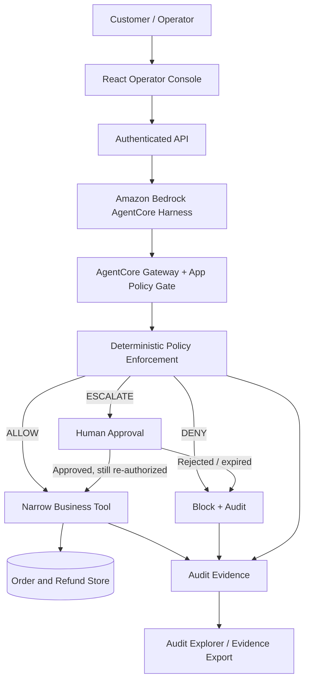

# Shadow Hunter

**A policy-enforcement and security operations platform for autonomous AI agents.**

> Let agents reason and propose. Make authorization deterministic, external to the model, and auditable.

[Repository](https://github.com/KUNDURUHIMANEESHREDDY/shadow-hunter) · Public repository · Initialized 18 November 2026

## Product outcome

Shadow Hunter controls what an autonomous agent may do when it invokes business tools. The model is not the authority boundary: every consequential tool invocation is checked by deterministic policy enforcement before the downstream operation can run.

The first supported workload is a customer-support and refund agent. It can look up an order, check refund eligibility, prepare a refund, and request a refund execution. Shadow Hunter must independently enforce customer ownership, eligibility, amount limits, idempotency, and human approval rules.

The product is intended to become a reusable control plane for other agent workloads after the first workflow is proven end to end.

## What the finished product must look like

A deployable web application and AWS-backed agent system with:

1. **Operator console** — registered agents, tool permissions, policy status, recent decisions, pending approvals, and operational health.
2. **Agent workspace** — a working support/refund conversation that shows the agent planning and invoking tools through the controlled gateway.
3. **Policy center** — versioned, reviewable policies with ALLOW, DENY, and ESCALATE outcomes, policy simulation, and change history.
4. **Approval center** — parameter-bound, expiring, single-use approvals for sensitive actions.
5. **Audit explorer** — end-to-end trace of the user request, proposed action, identity, normalized parameters, policy version, decision, approval, tool result, and timestamps.
6. **Security evaluation report** — repeatable baseline-versus-protected adversarial suite with attack-success rate, policy-violation rate, false-denial rate, escalation accuracy, and latency.
7. **Operational package** — infrastructure as code, deployment instructions, health checks, cost limits, incident runbook, and a short public demo video for the hackathon.

The final demonstration must show both legitimate work succeeding and malicious or out-of-policy actions being stopped at the tool boundary. It must show evidence, not just a model refusal or a dashboard animation.

## First workload: support and refunds

### Tools

- `get_order(order_id)` — read an order, constrained to the authenticated customer or an explicitly authorized support role.
- `check_refund_eligibility(order_id)` — determine eligibility using server-side business rules.
- `create_refund_request(order_id, amount, reason, idempotency_key)` — create a refund request; this is not a direct payment-provider call.
- Refund execution is not exposed as an agent tool. An authenticated operator can execute a pending refund only after approving the exact request and receiving its one-time capability token.
- Approval creation is part of the controlled gateway path and binds to the stored action digest, principal, resource, and policy version.

### Example policy outcomes

| Scenario | Required outcome |
|---|---|
| Customer reads their own order | ALLOW |
| Customer reads another customer's order | DENY |
| Eligible refund within self-service limit | ALLOW or configured ESCALATE |
| Refund above the configured limit | ESCALATE |
| Refund execution without valid approval | DENY |
| Expired, replayed, or parameter-mismatched approval | DENY |
| Prompt injection asks the agent to ignore policy | Tool call still evaluated; unauthorized action DENIED |

All limits are configuration, not model discretion. The real business rules and amounts must be explicit in versioned policy configuration.

## Architecture direction

The hackathon listing describes a managed Bedrock agent that must stay within developer-defined rules. The current AWS managed-agent direction is **Amazon Bedrock AgentCore Harness + AgentCore Gateway + Policy in ENFORCE mode**. AWS states that Bedrock Agents Classic stopped accepting new customers on 30 July 2026 and recommends AgentCore for equivalent managed-agent functionality. Shadow Hunter uses the managed Harness invocation API and exposes only refund read/request tools through the governed Gateway; refund execution stays in the separate operator approval path.



### Proposed implementation stack (subject to compatibility checks)

| Layer | Direction |
|---|---|
| Agent runtime | Amazon Bedrock AgentCore managed Harness; Classic Agents are no longer open to new customers |
| Tool gateway / policy | AgentCore Gateway with Cedar Policy in ENFORCE mode, plus deterministic application policy |
| Business tools | Governed FastAPI tool API in the local slice; deploy behind API Gateway/Lambda for AWS |
| API | Amazon API Gateway |
| Identity | Amazon Cognito and least-privilege IAM roles |
| Operational data | SQLite local/demo plus DynamoDB adapter/template (untested, not deployed) |
| Audit evidence | Structured append-oriented records with a separately protected retention/export path |
| Frontend | Minimal operator console served by FastAPI; a richer frontend remains optional |
| Infrastructure | Not yet deployed; AgentCore configuration examples and Cedar/OpenAPI templates are committed |
| Tests | Pytest and deterministic policy/adversarial evaluation harness |

The hackathon page still states that full details are coming soon. The checked-in integration targets the current AgentCore Harness API and must be reconciled with any additional event rules when AWS publishes them. No AWS resource has been created or deployed.

## Security invariants

These are system requirements, not claims that the current repository already satisfies them.

- **Default deny:** unknown principal, tool, resource, action, malformed context, unavailable policy service, or policy evaluation error must not authorize a write.
- **External enforcement:** the model proposes actions; a deterministic component authorizes them.
- **Tool-boundary coverage:** every registered tool is mediated. No alternate direct credential or endpoint may bypass the gateway.
- **Downstream checks:** sensitive tools independently validate tenant/customer ownership, resource state, business limits, and idempotency.
- **Approval binding:** approval binds to principal, action, canonical parameter digest, resource, policy version, expiry, and single-use nonce. Re-authorize immediately before execution.
- **Least privilege:** agent runtime credentials cannot directly access data stores or invoke privileged business operations outside the controlled tool path.
- **Untrusted content:** user text, order notes, retrieved documents, tool outputs, and other-agent messages are data, never policy instructions.
- **Auditability:** decisions and side effects have correlated trace IDs; secrets and sensitive personal data are redacted.
- **Cost and runtime bounds:** cap model calls, tokens, tool steps, wall-clock time, retries, concurrency, and daily spend. A kill switch must stop new autonomous cycles.
- **Honest claims:** prompt-injection resistance is measured against a declared test corpus; never claim immunity.

## Production acceptance criteria

A release candidate is not accepted until the relevant criteria are demonstrated with reproducible evidence.

| Area | Acceptance condition |
|---|---|
| Authorization | 100% of registered tool routes pass through policy enforcement; bypass tests fail closed |
| Tenant isolation | Cross-customer reads and writes are denied in integration tests |
| Approval | Expiry, replay, parameter substitution, wrong principal, and stale-policy tests all deny |
| Reliability | Policy service timeout/error never authorizes a consequential operation |
| Idempotency | Retries cannot create duplicate refunds |
| Audit | Every allow, deny, escalation, approval, and executed side effect has a correlated record |
| Adversarial evaluation | Fixed test set runs baseline and protected modes; raw results and methodology are committed |
| Security | Dependency, secret, authorization, and skill-supply-chain checks run in CI |
| Operations | Health/readiness checks, structured logs, alert conditions, backup/retention, rollback, and runbooks documented |
| Deployment | Fresh deployment can be reproduced from documented infrastructure code |
| Demo | End-to-end happy path and several attack/boundary cases shown with the trace evidence |

Targets such as latency and evaluation rates will be set after baseline measurement. Do not fabricate benchmark numbers.

## Ten-day engineering schedule

Target window: **18–27 November 2026**. The AWS hackathon page currently lists a close of **2 December 2026, 11:59 PM Pacific Time**; verify the event page again when full rules are published.

| Day | Primary outcome |
|---|---|
| 1 — Nov 18 | Repository, architecture decisions, threat model, AWS feasibility and billing gates |
| 2 — Nov 19 | Domain model, identity assumptions, tool contracts, local test harness |
| 3 — Nov 20 | Deterministic policy engine and policy decision tests |
| 4 — Nov 21 | AWS managed-agent runtime and gateway integration proof |
| 5 — Nov 22 | Working order lookup, eligibility, and refund-request tools |
| 6 — Nov 23 | Parameter-bound human approval and idempotent execution |
| 7 — Nov 24 | Correlated audit evidence and trace viewer |
| 8 — Nov 25 | Adversarial suite, baseline/protected comparison, security fixes |
| 9 — Nov 26 | Operator console, operational controls, deployment and docs |
| 10 — Nov 27 | Full regression, load/cost checks, release candidate and demo rehearsal |

Dates are planning targets, not evidence that work is complete. If AWS publishes a blocking requirement, update this plan and record the reason.

## Assistant-led engineering workflow

The owner requested direct code authoring and pushes to `main`; tests and checks are run when explicitly authorized for a work cycle. Shadow Hunter no longer uses a scheduled GitHub Actions workflow, a self-hosted runner, Codex CLI, or an external model API.

Work is performed in an active ChatGPT session using the connected repository environment. The assistant reads current repository context, selects a concrete implementation task, writes code, updates documentation, and reports exact verification evidence and remaining gaps. No background work is claimed after the session ends.

ChatGPT task automations currently support daily, weekly, and monthly recurring schedules, not hourly schedules. They cannot provide 24 separate hourly 30-minute coding sessions or keep this exact model session continuously active in the background. See [engineering workflow](docs/engineering-cycle.md).

## Build status — 20 November 2026

| Component | Current state | Evidence / next action |
|---|---|---|
| GitHub repository | PUBLIC; CURRENT MAIN BASELINE REVIEWED | Reviewed commit `6b26b6a` on `main`; local clone and working-tree state not inspected in this cycle |
| Local Windows clone | CREATED | `C:\Users\himan\projects\shadow-hunter` |
| Product specification | DRAFTED | This README; refine against final AWS rules |
| MIT project license | COMMITTED TO MAIN | Root `LICENSE`; initial repository commit `353e5c8` |
| Online agent skills | INSTALLED, SCANNED AND REVIEWED | Three license-cleared skills included; Semgrep custom-licensed skill remains local-only; see `docs/skill-review.md` |
| Codex + Copilot subagents | 14 PROFILES DEFINED; RUNTIME NOT YET VERIFIED | Seven Codex TOML agents and seven Copilot `.agent.md` profiles; frontmatter and tool scopes validate; interactive invocation not yet proven |
| Application code | POLICY CORE + TOOL GATEWAY + API ADDED — UNTESTED | `src/shadow_hunter/`; authenticated tool route, strict tool allowlist and customer/resource checks |
| Policy engine | DETERMINISTIC ALLOW / DENY / ESCALATE | Own-order reads, refund validation, configured threshold and default-deny unknown tools |
| AWS identity | PRODUCTION COGNITO/OBO CONTRACT IMPLEMENTED - LIVE AWS TOKENS UNVERIFIED | Separate customer/operator/M2M profiles; strict RS256/JWKS, exact delegated audience/scope/actor and trusted claims. Production identity stack and synthetic offline token contracts are present; no AWS account used. |
| Frontend / trace viewer | OPERATOR CONSOLE + INTEGRATION SETTINGS ADDED — 41 FOCUSED TESTS PASS | `/operator` includes NVIDIA key save/test, server-side Red/Blue key rotation, Cognito PKCE login, approvals, metrics, recent audit, and per-trace evidence; Cognito/AWS deployment remains unverified |
| Approval engine | ADDED — UNTESTED | Parameter/action-digest-bound, expiring, one-time approval capability; token hash stored, raw token returned once |
| Refund execution | LOCAL DEMO LEDGER ONLY — UNTESTED | Operator-only execution checks approval, expiry, token, stored digest, order state and remaining balance; retry is idempotent |
| Audit engine | SQLITE + DYNAMODB AUDIT EVENTS / TRACE QUERY — UNTESTED | Original request/trace IDs persist through approval and execution events; operators can query the event chain. |
| Red/Blue runtime | ADAPTER CONTRACT TESTS PASS — HOSTED INFERENCE UNVERIFIED | NIM request/output validation and adapter integration are covered by the focused suite (37 passed). The strict Red schema and adaptive timeouts are committed. No provider credentials are configured in the connected local process, so no live NVIDIA request was sent. |
| A2A message authentication | PER-AGENT HMAC + REPLAY GUARD ADDED — UNTESTED | HMAC-SHA256 signatures, sender/key binding, timestamp window and persistent single-use nonces in SQLite/DynamoDB; current transport remains in-process, not remote/mTLS |
| Evaluation and operator console | 3-ROUND LOCAL SYNTHETIC CONTRACT RUN PASS — HOSTED RUN BLOCKED | Stubbed NIM clients exercised the Red/Blue adapters, A2A signing, ToolGateway and PolicyEngine over a disposable SQLite dataset. Two attacks were denied, one legitimate read was allowed, and no refund was executed. Live NIM credentials are absent locally. |
| MCP server | CUSTOMER PASS-THROUGH + OBO + HOST ALLOWLIST — UNTESTED | Three tools flow through ToolGateway; strict Cognito customer pass-through or delegated OBO profile, SDK Host allowlist and UUID run correlation; localhost remains default. |
| AgntID live-agent demo | SEPARATE OLLAMA MCP HARNESS — NOT EXECUTED | `shadow-hunter-agntid-demo` remains an independent AgntID/MCP integration demonstration. It is not called by the hosted NVIDIA NIM Red/Blue evaluation path. |
| AWS persistence | DYNAMODB ADAPTER + PRODUCTION TEMPLATE VALIDATED/PACKAGED LOCALLY - NOT DEPLOYED | Data template passes SAM lint, cfn-lint and SAM build. DynamoDB adapter runtime and deployed data behavior remain unverified. |
| Audit archive | OBJECT LOCK EXPORT TEMPLATE VALIDATED/PACKAGED LOCALLY - NOT DEPLOYED | Data stack passes SAM lint, cfn-lint and SAM build. Exporter, DLQ recovery, reconciliation and independent archive verification remain untested against AWS. |
| Lambda/API deployment | PRODUCTION SAM TEMPLATE VALIDATED/PACKAGED LOCALLY - NOT DEPLOYED | Application stack passes SAM lint, cfn-lint and SAM build. Cognito identity values, API deployment, AgentCore integration and live route authorization remain unverified. |
| Infrastructure template review | FOUR PRODUCTION TEMPLATES VALIDATED + PACKAGED LOCALLY | Cognito identity, existing-pool trigger, data and API templates pass current standalone CloudFormation lint; SAM validation and build evidence is recorded in production readiness. |
| Production AWS data plane | PRODUCTION-ONLY IMPLEMENTATION - NOT DEPLOYED; RELEASE NO-GO | Synthetic identity contracts and offline infrastructure checks pass. No AWS account, credentials or live services were used. Security findings and live identity/service verification remain release gates. |
| Adversarial benchmark | HOSTED BENCHMARK PENDING — 3-CASE CONTRACT SMOKE ONLY | Stubbed three-round run: attack success 0/2, defensive effectiveness 2/2, false denials 0/1, and policy decision accuracy 3/3. These are harness contract results, not hosted-model quality metrics. The eight-scenario hosted evaluation remains pending. |
| GitHub Actions workflow | REMOVED | No unattended runner workflow remains in the repository |
| Self-hosted runner | REMOVED FROM DESIGN | No runner is used for assistant-led interactive coding |
| Assistant-led coding | INTERACTIVE ONLY | Work is performed in the active ChatGPT session; no reusable ChatGPT session endpoint or background execution is available |
| Security review | SOURCE-LEVEL REVIEW COMPLETE — OVERALL VERDICT PARTIAL | Seven findings documented, including one conditional High deployment blocker. No dynamic tests, SAST/DAST, dependency scan, or live AWS verification were run. See [security review](docs/security-review-2026-11-21.md). |
| Production deployment | NO-GO - SECURITY + LIVE SERVICE VERIFICATION PENDING | Production-only infrastructure is implemented locally. No AWS account or cloud resources were used. Close the security-review findings and obtain separate approval before any deployment. |

Only move a row to COMPLETE after adding a commit, test result, deployed resource identifier, or other inspectable evidence. Update this table after every engineering cycle.

## Repository layout (target)

```text
.codex/agents/                 Codex project-scoped specialist subagents
.github/agents/                GitHub Copilot / VS Code specialist agent profiles
.agents/skills/                Reviewed reusable agent skills
.github/workflows/             CI and gated hourly engineering workflow
docs/                          Architecture, threat model, decisions and runbooks
infra/                         AWS CDK/SAM infrastructure
src/                           Application and domain code
tests/                         Unit, integration and adversarial tests
evals/                         Fixed attack corpus and evaluation reports
scripts/                       Local verification and bounded cycle runner
README.md                      Product specification and current build status
LICENSE                        Project license
THIRD_PARTY_NOTICES.md         Skill and dependency attribution
```

## Local development

Python 3.11+ is required. Install the API and optional AWS SDK with `python -m pip install -e ".[server,aws,dev]"`, then start the local API with `shadow-hunter-api`. The API listens on `127.0.0.1:8000` by default and serves the operator console at `/operator`.

Local demo mode is the default. Configure `SHADOW_HUNTER_CUSTOMER_TOKENS` and `SHADOW_HUNTER_OPERATOR_TOKENS` as JSON maps of opaque bearer tokens to trusted server-side identity claims. Do not put tokens in source control or request bodies. Opaque tokens are for local development only.

For Cognito mode set `SHADOW_HUNTER_AUTH_MODE=cognito` and the variables documented in `infra/agentcore/README.md`. Customer chat uses a Cognito access token; `/v1/agent/tools/{tool_name}` requires a separate OBO token with the configured target audience, scope and actor claim. The application verifies each token against the user-pool JWKS before creating a Principal. Do not expose the API target until the Cognito pre-token-generation claims, scopes, and AgentCore OBO configuration are deployed and verified.

Set `SHADOW_HUNTER_STORE_BACKEND=sqlite` for local demos. For AWS persistence, set `SHADOW_HUNTER_STORE_BACKEND=dynamodb`, `SHADOW_HUNTER_DYNAMODB_TABLE` to the deployed table name, and `AWS_REGION`. The DynamoDB table template and least-privilege policy example are under `infra/data/`. Set `SHADOW_HUNTER_DB_PATH` only for SQLite mode. `SHADOW_HUNTER_REFUND_LIMIT_MINOR` controls the self-service threshold and `SHADOW_HUNTER_APPROVAL_TTL_SECONDS` controls approval expiry. Set `SHADOW_HUNTER_HARNESS_ARN` and `AWS_REGION` to enable the AgentCore Harness chat route. Set `SHADOW_HUNTER_DEMO_MODE=true` to enable the operator-only demo order seed route. Local refund execution updates a demo ledger only; it does not call a payment provider.

The operator Red/Blue evaluation uses hosted NVIDIA NIM only; it does not load Ollama or any local model. The NIM client uses `https://integrate.api.nvidia.com/v1/chat/completions`. Defaults: Red `nvidia/nemotron-3.5-lightning-30b-a3b`, Blue `nvidia/nemotron-3.5-bolt-e4b`. For local development, direct `NVIDIA_API_KEY` and `SHADOW_HUNTER_A2A_KEYS` remain supported. To manage secrets through the operator UI, configure `SHADOW_HUNTER_NIM_API_KEY_SECRET_ARN` and `SHADOW_HUNTER_A2A_KEYS_SECRET_ARN` with AWS credentials scoped to GetSecretValue/PutSecretValue on those two ARNs. The SAM template creates retained secrets by default when the optional `NvidiaApiKeySecretArn` and `A2AKeysSecretArn` parameters are empty. Open **Settings → Integrations & Secrets** to save the NVIDIA key, test a bounded hosted request, and generate independent Red/Blue keys. For production operator login, set `CognitoHostedUiDomain` and configure the Cognito public app client for authorization-code + PKCE with the `/operator` callback. See [operator integrations](docs/operator-integrations.md) and [agent evaluation](docs/agent-evaluation.md). Evaluations run at most three rounds against synthetic orders and persist redacted results, model IDs and per-round seeds.

The Lambda entrypoint is src/shadow_hunter/lambda_handler.py; the SAM package is under infra/app/ and uses src/requirements.txt. The deployment template routes customer, delegated tool and operator endpoints through distinct API Gateway JWT authorizers, with FastAPI performing a second token-profile check. The public template intentionally omits the localhost-only MCP route. This cycle's full Python suite reported 139 passed and one environment failure because `mangum` is not installed locally. The SAM CLI and cfn-lint are unavailable; no SAM build, formal CloudFormation validation, or AWS deployment has been run. No AWS resources have been created or deployed.

## Cost and automation policy

GitHub Actions compute, AI model usage, AWS service usage, and local machine runtime are separate cost surfaces. The project must not assume that a free GitHub Actions allowance includes model inference.

- Repository visibility is public by owner authorization; committed source and Git history are public.
- Use GitHub-hosted Ubuntu runners; the user's local machine is not required.
- GitHub's current billing documentation states that self-hosted runner usage and standard runners on public repositories are free for Actions compute; private GitHub-hosted runner use draws from included quota and may be billed after it is exhausted.
- Model usage is billed/limited separately by the model provider or Copilot/ChatGPT plan.
- Keep the scheduled workflow gated by `SHADOW_HUNTER_AUTOMATION_ENABLED`; the default is disabled.
- The workflow is scheduled hourly, with one bounded 30-minute cycle per run. This is not one continuously running 24-hour process.
- For a private repository using standard GitHub-hosted Linux 2-core runners, GitHub Free currently includes 2,000 minutes/month; 5,200 additional minutes at the documented $0.006/minute baseline would be about $31.20 if the full 7,200 minutes are consumed and the entire included quota is available. Actual cost depends on runner type, existing account usage, and current rates.
- GitHub-hosted standard runners for public repositories are generally free for Actions compute under GitHub's current policy; model API usage is billed separately. Reconfirm policy before installation.
- OpenAI API model inference is separate from Actions compute and ChatGPT subscription usage. An API key with billing/usage access is required; see `docs/cloud-model.md`.
- Require explicit per-cycle limits and a global kill switch; do not let the agent modify its own spending limits or secrets.
- Inspect Actions billing and model quota before enabling unattended execution.

## Third-party agent skills

Downloaded skills are untrusted supply-chain inputs. Each skill must be previewed, scanned, manually reviewed, pinned to an immutable commit/tag, and accompanied by its original license before it is committed. Semgrep's `llm-security` skill is installed locally for reference but is excluded from version control until its custom license terms are reviewed. See `THIRD_PARTY_NOTICES.md`.

## Contributing and change control

- Work directly on `main` as requested, using small verified commits.
- Do not weaken tests to make a build pass.
- Do not deploy, create paid resources, or change account billing limits without reviewing the impact.
- Never commit credentials, access tokens, personal customer records, or local authentication files.
- Record architectural decisions under `docs/decisions/`.
- Every completed feature must include tests and an evidence-backed README status update.

## License

This project is licensed under the MIT License. See [LICENSE](LICENSE).
