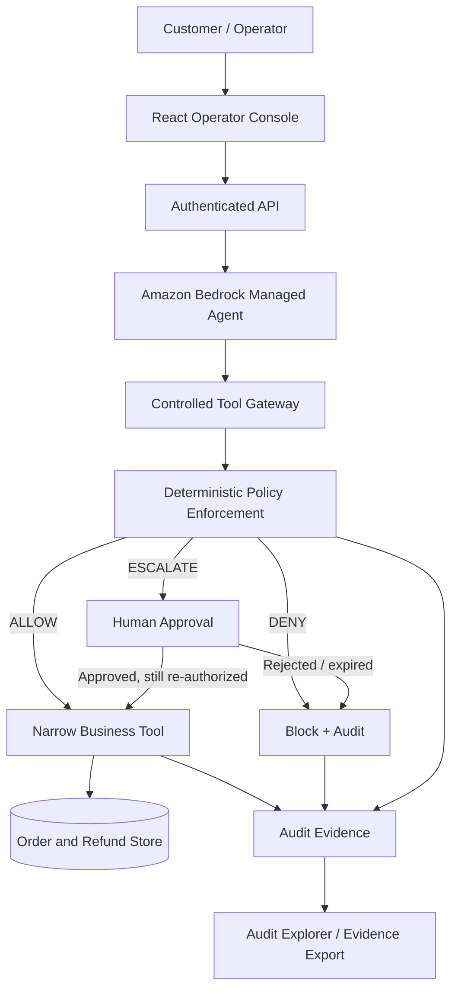

# Shadow Hunter

**A policy-enforcement and security operations platform for autonomous AI agents.**

> Let agents reason and propose. Make authorization deterministic, external to the model, and auditable.

[Repository](https://github.com/KUNDURUHIMANEESHREDDY/shadow-hunter) · Private project · Initialized 18 November 2026

## Product outcome

Shadow Hunter controls what an autonomous agent may do when it invokes business tools. The model is not the authority boundary: every consequential tool invocation is checked by deterministic policy enforcement before the downstream operation can run.

The first supported workload is a customer-support and refund agent. It can look up an order, check refund eligibility, prepare a refund, and request a refund execution. Shadow Hunter must independently enforce customer ownership, eligibility, amount limits, idempotency, and human approval rules.

The product is intended to become a reusable control plane for other agent workloads after the first workflow is proven end to end.

## What the finished product must look like

A deployable web application and AWS-backed agent system with:

1. **Operator console** — registered agents, tool permissions, policy status, recent decisions, pending approvals, and operational health.
2. **Agent workspace** — a working support/refund conversation that shows the agent planning and invoking tools through the controlled gateway.
3. **Policy center** — versioned, reviewable policies with ALLOW, DENY, and ESCALATE outcomes, policy simulation, and change history.
4. **Approval center** — parameter-bound, expiring, single-use approvals for sensitive actions.
5. **Audit explorer** — end-to-end trace of the user request, proposed action, identity, normalized parameters, policy version, decision, approval, tool result, and timestamps.
6. **Security evaluation report** — repeatable baseline-versus-protected adversarial suite with attack-success rate, policy-violation rate, false-denial rate, escalation accuracy, and latency.
7. **Operational package** — infrastructure as code, deployment instructions, health checks, cost limits, incident runbook, and a short public demo video for the hackathon.

The final demonstration must show both legitimate work succeeding and malicious or out-of-policy actions being stopped at the tool boundary. It must show evidence, not just a model refusal or a dashboard animation.

## First workload: support and refunds

### Tools

- `get_order(order_id)` — read an order, constrained to the authenticated customer or an explicitly authorized support role.
- `check_refund_eligibility(order_id)` — determine eligibility using server-side business rules.
- `create_refund_request(order_id, amount, reason, idempotency_key)` — create a refund request; this is not a direct payment-provider call.
- `execute_refund(refund_request_id, approval_token)` — execute only after policy authorization and valid human approval.
- `request_human_approval(action_digest, reason)` — create a pending approval bound to the exact action and canonical parameters.

### Example policy outcomes

| Scenario | Required outcome |
|---|---|
| Customer reads their own order | ALLOW |
| Customer reads another customer's order | DENY |
| Eligible refund within self-service limit | ALLOW or configured ESCALATE |
| Refund above the configured limit | ESCALATE |
| Refund execution without valid approval | DENY |
| Expired, replayed, or parameter-mismatched approval | DENY |
| Prompt injection asks the agent to ignore policy | Tool call still evaluated; unauthorized action DENIED |

All limits are configuration, not model discretion. The real business rules and amounts must be explicit in versioned policy configuration.

## Architecture direction

The hackathon listing explicitly names **Amazon Bedrock Managed Agents**. That is the required agent-runtime direction unless the final rules say otherwise. AWS also provides **Amazon Bedrock AgentCore Gateway and Policy**, with Cedar policy evaluation at the gateway. We will use those controls where the final Managed Agents integration path supports them, and retain a deterministic application-side enforcement adapter as a second boundary.



### Proposed implementation stack (subject to compatibility checks)

| Layer | Direction |
|---|---|
| Agent runtime | Amazon Bedrock Managed Agents, as required by the event |
| Tool gateway / policy | Amazon Bedrock AgentCore Gateway and Cedar Policy where compatible |
| Business tools | AWS Lambda |
| API | Amazon API Gateway |
| Identity | Amazon Cognito and least-privilege IAM roles |
| Operational data | DynamoDB initially; choose a relational store only if demonstrated necessary |
| Audit evidence | Structured append-oriented records with a separately protected retention/export path |
| Frontend | React + TypeScript |
| Infrastructure | AWS CDK or SAM; choose one after validating the runtime integration |
| Tests | Pytest and deterministic policy/adversarial evaluation harness |

The final hackathon rules and the exact Managed Agents / AgentCore integration contract are not yet published on the event page. Do not claim compliance with requirements that have not been released. Record and resolve this as an architecture decision before deployment.

## Security invariants

These are system requirements, not claims that the current repository already satisfies them.

- **Default deny:** unknown principal, tool, resource, action, malformed context, unavailable policy service, or policy evaluation error must not authorize a write.
- **External enforcement:** the model proposes actions; a deterministic component authorizes them.
- **Tool-boundary coverage:** every registered tool is mediated. No alternate direct credential or endpoint may bypass the gateway.
- **Downstream checks:** sensitive tools independently validate tenant/customer ownership, resource state, business limits, and idempotency.
- **Approval binding:** approval binds to principal, action, canonical parameter digest, resource, policy version, expiry, and single-use nonce. Re-authorize immediately before execution.
- **Least privilege:** agent runtime credentials cannot directly access data stores or invoke privileged business operations outside the controlled tool path.
- **Untrusted content:** user text, order notes, retrieved documents, tool outputs, and other-agent messages are data, never policy instructions.
- **Auditability:** decisions and side effects have correlated trace IDs; secrets and sensitive personal data are redacted.
- **Cost and runtime bounds:** cap model calls, tokens, tool steps, wall-clock time, retries, concurrency, and daily spend. A kill switch must stop new autonomous cycles.
- **Honest claims:** prompt-injection resistance is measured against a declared test corpus; never claim immunity.

## Production acceptance criteria

A release candidate is not accepted until the relevant criteria are demonstrated with reproducible evidence.

| Area | Acceptance condition |
|---|---|
| Authorization | 100% of registered tool routes pass through policy enforcement; bypass tests fail closed |
| Tenant isolation | Cross-customer reads and writes are denied in integration tests |
| Approval | Expiry, replay, parameter substitution, wrong principal, and stale-policy tests all deny |
| Reliability | Policy service timeout/error never authorizes a consequential operation |
| Idempotency | Retries cannot create duplicate refunds |
| Audit | Every allow, deny, escalation, approval, and executed side effect has a correlated record |
| Adversarial evaluation | Fixed test set runs baseline and protected modes; raw results and methodology are committed |
| Security | Dependency, secret, authorization, and skill-supply-chain checks run in CI |
| Operations | Health/readiness checks, structured logs, alert conditions, backup/retention, rollback, and runbooks documented |
| Deployment | Fresh deployment can be reproduced from documented infrastructure code |
| Demo | End-to-end happy path and several attack/boundary cases shown with the trace evidence |

Targets such as latency and evaluation rates will be set after baseline measurement. Do not fabricate benchmark numbers.

## Ten-day engineering schedule

Target window: **18–27 November 2026**. The AWS hackathon page currently lists a close of **2 December 2026, 11:59 PM Pacific Time**; verify the event page again when full rules are published.

| Day | Primary outcome |
|---|---|
| 1 — Nov 18 | Repository, architecture decisions, threat model, AWS feasibility and billing gates |
| 2 — Nov 19 | Domain model, identity assumptions, tool contracts, local test harness |
| 3 — Nov 20 | Deterministic policy engine and policy decision tests |
| 4 — Nov 21 | AWS managed-agent runtime and gateway integration proof |
| 5 — Nov 22 | Working order lookup, eligibility, and refund-request tools |
| 6 — Nov 23 | Parameter-bound human approval and idempotent execution |
| 7 — Nov 24 | Correlated audit evidence and trace viewer |
| 8 — Nov 25 | Adversarial suite, baseline/protected comparison, security fixes |
| 9 — Nov 26 | Operator console, operational controls, deployment and docs |
| 10 — Nov 27 | Full regression, load/cost checks, release candidate and demo rehearsal |

Dates are planning targets, not evidence that work is complete. If AWS publishes a blocking requirement, update this plan and record the reason.

## Hourly engineering cycle

The intended cadence is **one 30-minute engineering run every hour, 24 runs per day, for 10 days (up to 240 runs)**.

Each run must:
1. Read the current README, backlog, git status, recent commits, issues, and workflow/test results.
2. Select one highest-priority, non-duplicate task with explicit acceptance criteria.
3. Implement a coherent vertical slice or report a concrete blocker.
4. Run relevant tests, security checks, and `git diff --check`.
5. Update this README's build status and the durable engineering log.
6. Commit and push to `main` only when verification passes; never push secrets, fabricated evidence, or unverified work.

Runs must be serialized. A missed or delayed scheduled event is recorded; do not run overlapping sessions to compensate. Each agent run has a hard 30-minute timeout and a ten-day deadline guard. The workflow is gated off until the self-hosted runner and model authentication are configured and verified. Scheduled workflows can be delayed or dropped by GitHub during high load.

## Build status — 18 November 2026

| Component | Current state | Evidence / next action |
|---|---|---|
| Private GitHub repository | CREATED | Repository exists at the URL above |
| Local Windows clone | CREATED | `C:\Users\himan\projects\shadow-hunter` |
| Product specification | DRAFTED | This README; refine against final AWS rules |
| MIT project license | CREATED LOCALLY; STAGED FOR INITIAL COMMIT | Root `LICENSE`; included in staged repository foundation |
| Online agent skills | INSTALLED, SCANNED AND REVIEWED | Three license-cleared skills included; Semgrep custom-licensed skill remains local-only; see `docs/skill-review.md` |
| Codex + Copilot subagents | 14 PROFILES DEFINED; RUNTIME NOT YET VERIFIED | Seven Codex TOML agents and seven Copilot `.agent.md` profiles; frontmatter and tool scopes validate; interactive invocation not yet proven |
| Application code | NOT STARTED | Create domain model and test harness |
| Policy engine | NOT STARTED | Implement deterministic ALLOW / DENY / ESCALATE |
| AWS integration | NOT STARTED | Validate required Bedrock Managed Agents path |
| Frontend / trace viewer | NOT STARTED | Build after API and event contracts stabilize |
| Adversarial benchmark | NOT STARTED | Define fixed corpus and deterministic expected outcomes |
| GitHub Actions workflow | CREATED LOCALLY; DISABLED BY DEFAULT | Hourly cron at minute 7 UTC; 30-minute timeout; repository variable confirmed `false`; no runner registered |
| Self-hosted runner | NOT REGISTERED | Must register this machine with `shadow-hunter` label under a restricted runner identity |
| Autonomous model execution | NOT ENABLED | Codex CLI is authenticated interactively; non-interactive repo inspection was blocked by local CLI sandbox/MCP configuration; unattended auth/quota unverified |
| Production deployment | NOT STARTED | Requires AWS account/region, billing guard, IAM and deployment validation |

Only move a row to COMPLETE after adding a commit, test result, deployed resource identifier, or other inspectable evidence. Update this table after every engineering cycle.

## Repository layout (target)

```text
.codex/agents/                 Codex project-scoped specialist subagents
.github/agents/                GitHub Copilot / VS Code specialist agent profiles
.agents/skills/                Reviewed reusable agent skills
.github/workflows/             CI and gated hourly engineering workflow
docs/                          Architecture, threat model, decisions and runbooks
infra/                         AWS CDK/SAM infrastructure
src/                           Application and domain code
tests/                         Unit, integration and adversarial tests
evals/                         Fixed attack corpus and evaluation reports
scripts/                       Local verification and bounded cycle runner
README.md                      Product specification and current build status
LICENSE                        Project license
THIRD_PARTY_NOTICES.md         Skill and dependency attribution
```

## Local development

The repository is being initialized on Windows. Once the first application scaffold is committed, this section must contain tested setup commands, required environment variables, local AWS mocking instructions, test commands, and deployment instructions. Do not publish example secrets or real customer records.

## Cost and automation policy

GitHub Actions compute, AI model usage, AWS service usage, and local machine runtime are separate cost surfaces. The project must not assume that a free GitHub Actions allowance includes model inference.

- Keep the repository private.
- Prefer a dedicated self-hosted runner only after confirming isolation and repository permissions.
- GitHub's current billing documentation states that self-hosted runner usage and standard runners on public repositories are free for Actions compute; private GitHub-hosted runner use draws from included quota and may be billed after it is exhausted.
- Model usage is billed/limited separately by the model provider or Copilot/ChatGPT plan.
- Keep the scheduled workflow gated by `SHADOW_HUNTER_AUTOMATION_ENABLED`; the default is disabled.
- The target cadence is 24 × 30-minute runs/day for 10 days: up to 7,200 runner-minutes (120 runner-hours).
- For a private repository using standard GitHub-hosted Linux 2-core runners, GitHub Free currently includes 2,000 minutes/month; 5,200 additional minutes at the documented $0.006/minute baseline would be about $31.20 if the full 7,200 minutes are consumed and the entire included quota is available. Actual cost depends on runner type, existing account usage, and current rates.
- A self-hosted runner's Actions compute is currently free per GitHub's billing documentation, but the user's PC must stay online and incurs local electricity/hardware use. Reconfirm policy before installation.
- Model inference / Copilot AI credits are separate from Actions compute. GitHub Copilot plans measure agent, CLI and code-review use with AI credits; the Free plan has limited usage. Codex/ChatGPT account quotas are also separate.
- Require explicit per-cycle limits and a global kill switch; do not let the agent modify its own spending limits or secrets.
- Inspect Actions billing and model quota before enabling unattended execution.

## Third-party agent skills

Downloaded skills are untrusted supply-chain inputs. Each skill must be previewed, scanned, manually reviewed, pinned to an immutable commit/tag, and accompanied by its original license before it is committed. Semgrep's `llm-security` skill is installed locally for reference but is excluded from version control until its custom license terms are reviewed. See `THIRD_PARTY_NOTICES.md`.

## Contributing and change control

- Work directly on `main` as requested, using small verified commits.
- Do not weaken tests to make a build pass.
- Do not deploy, create paid resources, or change account billing limits without reviewing the impact.
- Never commit credentials, access tokens, personal customer records, or local authentication files.
- Record architectural decisions under `docs/decisions/`.
- Every completed feature must include tests and an evidence-backed README status update.

## License

This project is licensed under the MIT License. See [LICENSE](LICENSE).
