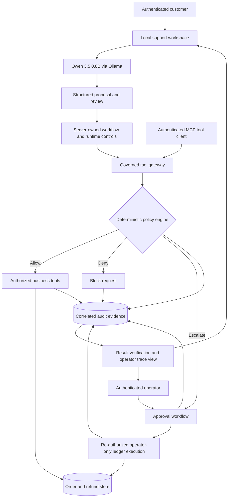

# Shadow Hunter

**Autonomous intelligence. Deterministic security.**

Shadow Hunter is a security and governance control plane for AI agents. It separates model reasoning from authorization, so an agent can interpret a request and propose a workflow without deciding its own permissions.

The first implemented workload is customer support and refund management. A local AI workspace, policy-controlled tools, human approval controls and traceable evidence demonstrate how useful agentic workflows can operate within defined boundaries.

[](LICENSE)
[](pyproject.toml)
[](src/shadow_hunter/local_runtime.py)

> **Development status:** Local prototype verified with synthetic records and real local model inference. Production release is not approved.

## Why Shadow Hunter?

AI agents can misunderstand instructions, propose invalid actions or encounter untrusted content. A model's confidence is not sufficient authorization. Shadow Hunter places deterministic policy enforcement outside the model, checks authenticated identities and resource ownership, and records evidence of each decision.

## Capabilities

| Component | Implemented capability |
| --- | --- |
| Policy engine | Deterministic ALLOW, DENY and ESCALATE decisions; default-deny authorization |
| Governed MCP tools | Order lookup, refund eligibility and controlled refund-request creation |
| Local AI workspace | Qwen 3.5 0.8B via Ollama; structured read-only plans, separate plan review and dependency checks |
| Execution verification | Correlated policy decisions, result validation and one bounded recovery attempt for inconsistent compound reads |
| Human approval | Expiring, parameter-bound, single-use approval capabilities; operator-only refund execution |
| Audit and history | Correlated decision records, trace queries and account-scoped local task history |
| Operator console | Policy evidence, approvals, operational settings and evaluation results |
| Runtime controls | Model readiness, two concurrent planner sessions, bounded workflow admission, cancellable inference HTTP requests and queue timeouts |

The local model workspace is restricted to order information and refund eligibility. Refund-request creation is available through the separate governed tool interface; actual refund execution is never exposed as a model tool. Demo refund execution updates an internal ledger, not a payment provider.

## Architecture



The model proposes; the server validates the plan and identity; the gateway authorizes each invocation. Human approval does not replace authorization, and results are checked against the associated policy evidence.

### Technology stack

| Layer | Technology |
| --- | --- |
| Application and policy | Python, FastAPI, Uvicorn |
| Local intelligence | Ollama, Qwen 3.5 0.8B |
| Tool protocol | Model Context Protocol (MCP) |
| Frontend | Browser-based HTML, CSS and JavaScript |
| Local persistence | SQLite |
| Optional cloud adapters | DynamoDB, Cognito, Amazon Bedrock AgentCore, Cedar policy templates |
| Verification | Pytest, Playwright, deterministic synthetic evaluation |

## Run locally

Use Python 3.11+, Git and an installed Ollama runtime. The following Windows PowerShell example is for a fresh **localhost-only synthetic demo**, not a production deployment.

```powershell
git clone https://github.com/KUNDURUHIMANEESHREDDY/shadow-hunter.git
cd shadow-hunter
py -3.11 -m venv .venv
.\.venv\Scripts\python.exe -m pip install -e ".[server,dev]"
```

Start Ollama locally if it is not already running. Install the required model with:

```powershell
ollama pull qwen3.5:0.8b
```

In a fresh PowerShell session, from the repository root, configure isolated local identities and a new demo database:

```powershell
$customer = [guid]::NewGuid().ToString("N")
$operator = [guid]::NewGuid().ToString("N")
$customers = @{}
$customers[$customer] = @{
    subject_id = "demo-subject"
    tenant_id = "demo-tenant"
    customer_id = "demo-customer"
}
$operators = @{}
$operators[$operator] = @{ subject_id = "demo-operator" }

$env:SHADOW_HUNTER_CUSTOMER_TOKENS = $customers | ConvertTo-Json -Compress
$env:SHADOW_HUNTER_OPERATOR_TOKENS = $operators | ConvertTo-Json -Compress
$env:SHADOW_HUNTER_AUTH_MODE = "local"
$env:SHADOW_HUNTER_STORE_BACKEND = "sqlite"
$env:SHADOW_HUNTER_DB_PATH = "demo-$([guid]::NewGuid().ToString('N')).sqlite3"
$env:SHADOW_HUNTER_LOCAL_READONLY_ENABLED = "true"
$env:SHADOW_HUNTER_DEMO_MODE = "true"
$env:SHADOW_HUNTER_EVAL_ENABLED = "false"

Write-Host "Local customer token: $customer"
Write-Host "Local operator token: $operator"
.\.venv\Scripts\shadow-hunter-api.exe
```

Keep the tokens private. In a fresh, non-cloud-configured development environment, the app listens on `127.0.0.1:8000` by default. Never expose the local demo server to the public Internet.

Open [the operator console](http://127.0.0.1:8000/operator), authenticate with the generated operator token and seed the synthetic order using the demo seed control or the authenticated `POST /v1/operator/demo/seed` endpoint. Then open [the local workspace](http://127.0.0.1:8000/local-workspace), authenticate with the generated customer token, check model readiness, enter order ID `order-demo-001` and try:

> Show my order details and check refund eligibility.

The workspace displays the verified result, live activity and task history. Cancellation closes the active streamed-task inference HTTP request and stops at subsequent execution checkpoints. Ollama's internal compute interruption has not been independently verified.

### Local interfaces

| Interface | Path |
| --- | --- |
| Durable approved job queue | `/v1/agent/local-jobs` |
| Local AI support workspace | `/local-workspace` |
| Operator console | `/operator` |
| Customer interface (managed-runtime integration) | `/customer` |
| Health | `/health` |
| API documentation | `/docs` |
| MCP server | `/mcp/` |

## Verification and evidence

Recorded development results from **24 November 2026**:

| Verification | Recorded result | Tested revision |
| --- | --- | --- |
| Full non-browser regression | 457 passed, 1 opt-in test skipped | [6a97a08](https://github.com/KUNDURUHIMANEESHREDDY/shadow-hunter/commit/6a97a085d5ed8dc2b1a3a930759ea30ef8830d3d) |
| Latest queue-cancellation patch | 91 targeted passed, 1 opt-in test skipped | [30337b9](https://github.com/KUNDURUHIMANEESHREDDY/shadow-hunter/commit/30337b9f079ae6ba2f83bf8b866480d0bfd05d8b) |
| Live local HTTP, streaming and browser E2E | 9 passed | [457d5a2](https://github.com/KUNDURUHIMANEESHREDDY/shadow-hunter/commit/457d5a21f9bb178d7ca7dc6ee13b69a86b700399) |
| Live cancellation checkpoint and expanded browser controls | 2 passed | [33b5be6](https://github.com/KUNDURUHIMANEESHREDDY/shadow-hunter/commit/33b5be6e412ed2febc3c2b930081ac21e786ff60) |
| Language workflow benchmark | 12/12 acceptable outcomes; 11/12 exact intent | 457d5a2 |
| Support intent-boundary benchmark | 12/12 expected outcomes | 457d5a2 |
| Local synthetic defensive evaluation | 8/8 expected outcomes, no executed refunds | [Submission evidence](docs/hackathon/README.md) |

These results apply to the stated revisions and bounded test corpora. They do not establish universal security, unrestricted task understanding, production readiness or successful hosted sponsor integration.

Run the non-browser suite in the isolated development environment:

```powershell
.\.venv\Scripts\python.exe -m pytest -q --ignore=tests/e2e
```

For opt-in live model and browser testing, start Ollama, ensure the required model is installed, install Playwright and have Microsoft Edge available:

```powershell
.\.venv\Scripts\python.exe -m pip install playwright pytest-playwright
$env:RUN_LOCAL_QWEN_E2E = "1"
.\.venv\Scripts\python.exe -m pytest -q tests/e2e/test_local_runtime_live.py --browser-channel msedge
.\.venv\Scripts\python.exe -m pytest -q tests/test_local_runtime.py::test_live_model_cancellation_checkpoint
Remove-Item Env:RUN_LOCAL_QWEN_E2E
```

## Optional integrations

The local prototype does not require cloud inference or sponsor accounts.

| Integration | Role | Verification status |
| --- | --- | --- |
| BAND | Redacted policy-decision publication | Live collaboration not verified |
| Lyzr | Advisory inference | Live collaboration not verified |
| NVIDIA NIM | Optional hosted evaluation | Current hosted benchmark not verified |
| AWS AgentCore and Cognito | Optional managed deployment and identity | Managed execution and live delegated two-tenant release gates remain open |

See [sponsor integrations](docs/sponsor-integrations.md), [keyless authentication](docs/keyless-auth.md) and the [hackathon submission kit](docs/hackathon/README.md). External integrations do not expand the model's execution authority.

## Scope and roadmap

The prototype currently supports one bounded customer-support workload. The local planner admits two concurrent planning sessions and two waiting requests, with a five-second queue wait and a 45-second planning budget. Eight interactive workflow lifetimes may be admitted at once. A durable SQLite job queue accepts explicitly selected business-read and local utility capabilities, with up to four independent dispatched jobs. Explicit one-time and bounded recurring automatic scheduling is supported. Delays may be up to an hour, recurrence intervals 60 seconds to 24 hours, with 2?20 runs over at most seven days. Jobs expire five minutes after their due time, and recurrence stops on denial, failure or expiry. The dependency ledger validates the entire allowlisted graph and exposes ready nodes; the support workload retains serial dependent reads and gateway verification. Streamed inference cancellation closes its HTTP request without terminating the shared Ollama process. Two concurrent live requests returned correct plans in 6.156 seconds; this does not prove parallel compute inside Ollama. The durable queue stores job identity, owner, registered capability, bounded input, state, due time, expiry, lease and trace metadata. Do not submit sensitive numerical inputs. Authenticated dispatch claims queued jobs transactionally, and expired leases are marked interrupted rather than silently replayed. The workspace supports queue, cancel queued jobs and dispatch a batch of up to four. Registered utilities provide local model readiness, bounded decimal summaries, unit conversion and fixed-allowlist public GitHub repository metadata. The workflow builder accepts explicit dependency graphs of at most eight registered nodes with two concurrent executions per graph; it validates the entire graph before dispatch. The local worker revalidates explicitly granted scheduled jobs against the current configured account identity. Set SHADOW_HUNTER_AUTO_JOBS_ENABLED=false to disable automatic dispatch. The worker requires a running backend; arbitrary external domains, unrestricted tool access and open-ended recurrence are not supported.

Further work includes broader approved support coverage, additional capability adapters, broader workflow adapters, repeatable live-model reliability measurements, latest-patch full regression and browser testing, and independent production verification. No production-ready deployment or verified public demo is claimed.

## Repository guide

| Path | Purpose |
| --- | --- |
| [src/shadow_hunter/](src/shadow_hunter/) | Application, policy, gateway, local runtime and persistence |
| [tests/](tests/) | Regression and end-to-end verification |
| [docs/](docs/) | Architecture, security decisions and operational documentation |
| [infra/](infra/) | Optional cloud infrastructure and deployment configuration |
| [scripts/](scripts/) | Local verification and demonstration utilities |

For detailed historical milestones and release gates, see the [previous README snapshot](https://github.com/KUNDURUHIMANEESHREDDY/shadow-hunter/blob/1969e7ed5e26493ae9aead45ec11dcda5983ffb9/README.md) and [architecture documentation](docs/architecture.md).

## License

Released under the [MIT License](LICENSE). See [third-party notices](THIRD_PARTY_NOTICES.md) for applicable attribution.

### Natural-language workflow preview

Use the workflow builder's Generate plan button or POST /v1/agent/local-workflows/plan with an objective and optional order_id. The hybrid compiler grounds supported utility inputs and uses reviewed local Qwen classification for ambiguous support reads. Explicit 'then' clauses form dependency barriers; independent 'and' clauses may run together. Preview never executes tools. Review and submit the graph separately. Unsupported or ambiguous clauses require clarification; arbitrary natural-language tasks are not guaranteed.

### Dynamic capability catalog

GET /v1/agent/local-capabilities exposes authenticated, read-only capability metadata. The planner uses catalog matching and grounded input validation, with reviewed Qwen classification for ambiguous support requests. SHADOW_HUNTER_ENABLED_CAPABILITIES optionally restricts the seven compiled-in adapters using comma-separated names; an empty value or unknown name fails closed. The same restriction is checked by queue and graph execution, and the workspace populates its selector from the server catalog. This is an additional execution restriction, not a replacement for the policy gateway. It does not install arbitrary tools or discover external MCP servers.

### Adaptive read-only workflow recovery

The graph executor schedules ready nodes as execution slots become free. A temporary connection failure or HTTP 502/503/504 without Retry-After from the approved public GitHub metadata adapter permits one retry of the identical capability and resource after a short backoff (maximum four retries per graph). It revalidates capability restrictions immediately before each attempt. Authorization failures, rate limits, other HTTP failures, malformed results, audit errors and unknown exceptions are never retried automatically. Failed prerequisites block all downstream dependents; independent branches continue. Responses include attempt counts, recovery events and residual graph revisions. This does not invent substitute tools, remove failed prerequisites, or change permissions.

### Optional MCP client and companion

The original authenticated MCP gateway remains unchanged. A separate, read-only public-data companion adds MCP tools for approved Python package versions and GitHub repository metadata. To run the local companion from an installed source checkout: `python -m shadow_hunter.mcp_companion`. It listens only on 127.0.0.1:8766. Set `SHADOW_HUNTER_MCP_COMPANION_ENABLED=true` in the Shadow Hunter backend environment before launching the backend. The workspace's Check MCP connections button performs real MCP discovery; the local capabilities catalog exposes the two configured tools (nine total when enabled). Example: Get PyPI package version for requests and get GitHub stars for python/cpython via MCP. Review the plan before execution. The client initializes a session, validates discovered tool names and input schemas, invokes only approved public resources, and validates structured results. No credentials, private account data, arbitrary endpoints, remote tool installation or write tools are supported by the companion. Leave disabled when unused. The separate loopback companion is not a production multi-user authentication boundary.

### Opt-in persistent workflow memory

The local workspace can explicitly remember a sanitized workflow outcome for 30 days. It stores capability names, execution statuses, bounded retry counts and validated public metadata or model readiness. It excludes raw objectives, order identifiers, private business results, numeric inputs, credentials and model text. The authenticated memory API supports viewing, deleting and clearing account-scoped records. A subsequent workflow preview can optionally display up to three relevant historical matches by capability. These matches never grant permission or replace fresh evidence. Retention is bounded to 30 records per account and 3000 globally; expired rows are pruned on memory access. Clearing memory invalidates in-flight save grants. Memory is stored in the local SQLite database; physical secure erasure, automatic background expiry and vector-based retrieval are not implemented.

### Independent result verification

Graph nodes and queued jobs pass through a separate deterministic verifier before completion. Numeric outputs are recomputed with rational arithmetic; support reads are checked against policy audit events, authenticated ownership and the current trusted order record. Public GitHub and PyPI results, including MCP results, are corroborated with a fresh fixed-origin HTTPS read. Model health is checked with a separate loopback probe. Successful results include verifier-owned method and timestamp metadata. A missing, mismatched or unavailable verification source fails closed and blocks dependent nodes. Denied support results are audit-checked and their candidate business payload is suppressed. Public-source changes between reads may cause conservative rejection; this does not prove the upstream provider itself is correct. This verification layer covers the registered read-only graph and queued capabilities, not arbitrary external actions or all legacy endpoints.

### Explicit durable workflow checkpoints

Use Save workflow for resume in the local workspace to persist an approved utility or public-data graph, then Advance next step to execute one ready node at a time. The authenticated /v1/agent/local-checkpoints API supports create, list, advance and delete. SQLite transactions retain exact normalized graph inputs and verified outputs for seven days, with 12 saved graphs per account and 500 globally. No free-form objectives, credentials or private support capabilities are stored. Previously verified ancestors are revalidated against current capability policy and evidence before a dependent node runs, without invoking their adapters again. Atomic claims prevent concurrent execution of a node; an expired 120-second claim becomes interrupted and is never replayed automatically. Descendants are blocked, independent nodes remain resumable, and stored results are labeled historical. This opt-in feature uses explicit one-node advancement, not unattended recovery or durable parallel execution. Expired records are removed on checkpoint access; this is not secure physical erasure.

### Live orchestration monitor

Run workflow now streams authenticated NDJSON from POST /v1/agent/local-workflows/stream. The monitor renders the server-validated dependency graph, running/verifying/verified/denied/failed/blocked states, ordered server events, elapsed time, retry counts and graph revisions. Progress counts only verified nodes; the final result retains the existing JSON format and opt-in memory behavior. Disconnect or Stop after active steps closes the stream and signals the executor to stop dispatching new nodes; already running reads may finish. Admission remains bounded until the worker exits. Streaming is scoped to the active graph request; no cross-session live subscription, historical event replay, or forced interruption of active adapters. Existing synchronous graph and explicit saved-checkpoint APIs remain supported.

### Orchestration benchmark

Run `python scripts/benchmark_orchestration.py` from an installed development checkout for 15 reproducible offline scenarios with synthetic accounts and controlled fault injection. Add `--live-model` to test the running local Ollama model, and `--live-mcp` to start a temporary loopback companion and corroborate real public GitHub/PyPI results. Use `--output report.json` to save per-case results and latency. The script exits nonzero if any case fails. Live checks are opt-in and reported separately from deterministic tests. The benchmark measures bounded approved read-only workflows, not general-purpose autonomy or production reliability.
