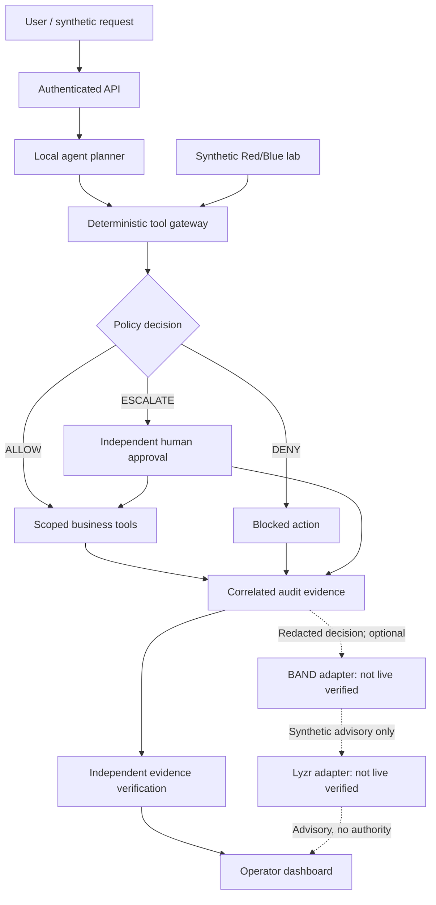

# Submission architecture

Solid lines depict the local application architecture, including the separately bounded synthetic lab. Dotted lines denote optional sponsor paths with no live evidence at the tested baseline. The approval service and operator-only execution retain independent authorization checks. No real payment operation is performed in the demo.
